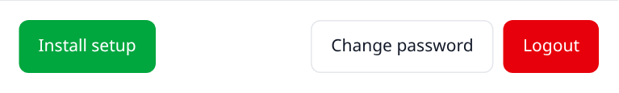
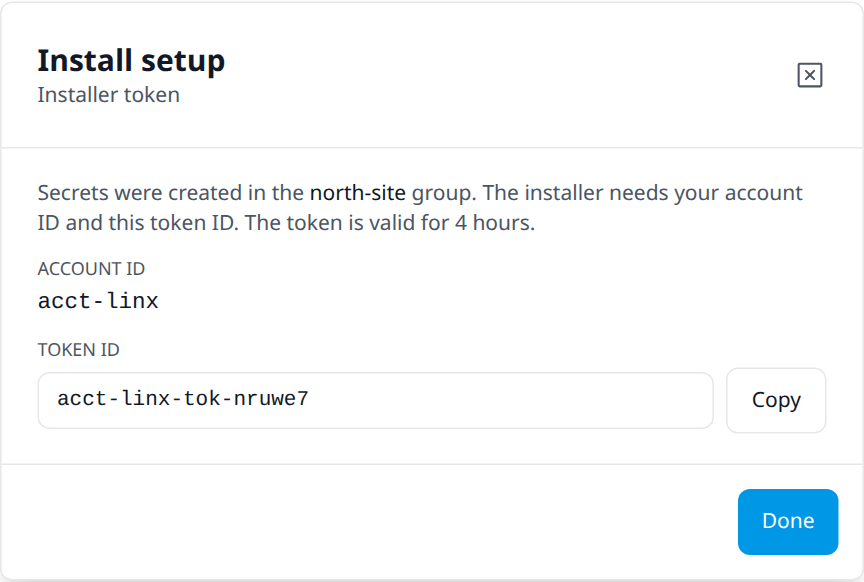

# Install CertLocker

You’ll use two places during installation. First, sign in to CertLocker Trust in your browser to tell the installer about your site. Then run the installer on your own macOS or Linux workstation. When setup finishes, your users sign in at **your front-office URL**.

| What do you have today? | Choose in Trust | Follow this path |
| --- | --- | --- |
| Two Ubuntu servers you can reach over SSH, including physical servers or public or private cloud instances | **GENERIC** | [Install on existing machines](#install-on-existing-machines) |
| A Google Cloud project where you want CertLocker to create and configure two VMs | **GCP** | [Create servers in Google Cloud](#create-servers-in-google-cloud) |

## Prepare your installation in Trust

1. Sign in to your customer account as a **super user**. Select your display name in the header to open **User Details**, then select **Install setup** at the bottom of the panel. [Open CertLocker Trust](https://trust.certlocker.io)

   

2. Enter an **install name** you will recognize later, such as `north-site`. Choose **GENERIC** or **GCP** using the table above. For GENERIC, have both servers’ SSH addresses and a key authorized on both machines. For GCP, you can leave the SSH username and key blank and let the installer generate a key.
3. Enter your Cloudflare zone, service URLs, administrator details and SMTP settings. For a zone such as `example.org`, use distinct names such as `https://app.example.org`, `https://admin.example.org` and `https://grafana.example.org`. Use an administrator mailbox you can read. It receives the sign-in code. Select **Test SMTP** for a public mail server, then **Create**. [Field-by-field guide and screenshots](PREREQUISITES.md#prepare-the-trust-installation)
4. Keep the final screen open. You’ll enter its **Account ID** and paste its **Token ID** at the workstation’s hidden deployment-token prompt. New setup tokens default to four hours.

   

On your workstation, download the installer and enter its directory:

```sh
git clone https://github.com/certlocker-io/certlocker-install.git
cd certlocker-install
```

If the launcher offers to prepare the controller tools, complete the prompts on this workstation. On macOS, have Docker Desktop running when the packaged controller is used. Use the same checkout and workstation for later updates or recovery. The commands below use `north-site` as an example. **Replace it with your installation name.** Follow only the path you chose in Trust.

## Install on existing machines

Use two dedicated Ubuntu 24.04 amd64 servers. We recommend 8 GiB RAM per server. The SSH user must have passwordless sudo on both. Public IPs work directly from the internet. For private IPs, connect your workstation to a network or VPN that routes to both servers.

Before running the installer, configure the provider security groups and any upstream firewalls:

| Allow this traffic | Source | Destination |
| --- | --- | --- |
| TCP **22** for SSH | Your installer workstation | Both servers |
| TCP **80** for HTTP and **443** for HTTPS | Your workstation for verification, and your clients or load balancer for application traffic | Both servers |
| UDP **51820** for the encrypted link | Each server | The other server, in both directions |

Enter your client or load-balancer source ranges in **Ingress IPv4 networks** in Install setup. If the application is public, you can put a public load balancer in front and allow its source ranges on both hosts. Point the application DNS names at that entry point. Grafana needs a route from your allowed monitoring addresses. [Detailed network checklist](PREREQUISITES.md#bare-metal-network-checklist)

**Check the servers first.** This checks SSH access, host identity and peer connectivity. The installer discovers the peer addresses for you.

```sh
./uncloudctl bare-metal north-site --preflight-only
```

**Install after the check passes.** Supply the same Trust account ID and deployment token when prompted. The installer configures the hosts, database, application, certificates and monitoring.

```sh
./uncloudctl bare-metal north-site
```

## Create servers in Google Cloud

Have a billed Google Cloud project with Compute Engine enabled, permission to create VMs and network resources, and one free VPC network slot. The default public routing also requires Cloudflare Load Balancing for your zone. [Google and Cloudflare prerequisites](PREREQUISITES.md)

```sh
./uncloudctl up
```

1. Enter the Account ID and Token ID from Trust. Use your install name when asked for a company or environment name.
2. Sign in to Google in the browser and select the project that should own and pay for the VMs. Choose two different zones. The default VM size is `e2-standard-2` (2 vCPUs, 8 GiB RAM), with a 100 GiB boot disk per VM.
3. Confirm any site settings still needed. For a production site choose **Production**. Supply the public egress IPs from which you need monitoring access. The installer also allows the CertLocker update and monitoring sources `88.81.117.228/32` and `185.88.0.182/32`.
4. Leave the installer running through verification. It creates the infrastructure, installs the application on both VMs, obtains the TLS certificate and configures Cloudflare routing. It saves your Google settings in `uncloud/environments/north-site.json` for the next run.

## Sign in and check your site

Wait for the installer to report that setup passed. Open the **front-office URL you entered in Trust**, sign in with the initial administrator email and password, then enter the verification code sent to that mailbox. If you left the password blank in Trust, use the password you set at the installer's hidden prompt.

Open your **backoffice URL** to check administrative access. Open your **Grafana URL** from an allowed monitoring address. If the installer passed but the public site is unreachable, check where the hostname resolves and whether TCP 443 reaches the load balancer and both origins.

## If setup stops

Keep the checkout, generated inventory and controller state. Correct the reported problem, then use the same install name and Trust account.

| What stopped? | What to do |
| --- | --- |
| Trust rejects an expired token | In your hosted Trust account, open **Tokens**. Check the installation’s group deployment token and its configuration token. Renew expired tokens. At the installer prompt, enter the group deployment token shown by Install setup. |
| Existing-server setup | Run `./uncloudctl bare-metal north-site --continue`. To check an already installed pair, use `--verify-only`. |
| Google Cloud setup | Run `./uncloudctl check --config uncloud/environments/north-site.json` and follow its recovery command. For a partially provisioned pair, this is usually `resume --config uncloud/environments/north-site.json`. If provisioning never started, retry `up --config` with the same file. |
| Google reports a VPC quota error | Free one network slot in the selected project or increase its quota, then follow the recovery command. |
| Certificate or SMTP checks fail | Check the Cloudflare token’s permissions for the chosen zone, or the SMTP hostname, port, TLS mode and credentials. For a private mail relay, ensure your installer workstation can reach it. |

### What to keep for recovery

Back up the installer checkout’s generated inventory (`inventory/uncloud/north-site/`) and the private controller state. Google installations also use the saved `uncloud/environments/north-site.json` profile and a dedicated provisioning key. Keep these files in access-controlled storage.

For unattended Google installs, provide a **completed** company profile and inject the deployment token as `CERTLOCKER_TOKEN` or `TRUST_TOKEN` through your secret manager. Supply the Trust account ID with `--account-id` if it is absent from the profile. Run `./uncloudctl up --non-interactive --config uncloud/environments/north-site.json`. The deployment token is distinct from the initial administrator password.

## Update an installed pair

From the original checkout, pull the current installer and preview the release. The preview uses the bundled [release manifest](../releases/current.json). Check that the proposed release and company are the ones you intend to update.

```sh
git pull --ff-only
./uncloudctl update north-site --plan
```

When ready, run `./uncloudctl update north-site`. Both nodes and HAProxy must be healthy. The updater drains and updates one node at a time. A deployment with a single active API owner can briefly interrupt requests during handover. If the update stops, resolve the reported health or drain issue and rerun it from the same checkout.

## Remove an installation

**Back up any application or PostgreSQL data you need before removal.** Use the command for the installation you intend to remove.

| Installation | Removal command | What it removes |
| --- | --- | --- |
| Existing servers | `./uncloudctl bare-metal uninstall north-site` | Removes the installed stack, database, monitoring, and mesh from both machines. The machines remain yours. |
| Google Cloud | `./uncloudctl destroy --config uncloud/environments/north-site.json --remove-dns --remove-trust` | Removes the deployment’s DNS routing, VMs, boot disks, reserved addresses, network resources and deployment credentials. |

The existing-server uninstaller checks both machines before asking you to type the company name. If the deployment token has expired, an authorized workstation SSH login (`--workstation-ssh`) or key (`--ssh-key PATH`) can remove the stack. Renew the group token and rerun the uninstall command to finish Trust cleanup before reinstalling.

For Google Cloud, keep the saved profile if you intend to reinstall using the same settings. After a verified destroy, `./uncloudctl clean --config uncloud/environments/north-site.json` also removes the local profile and controller state.
