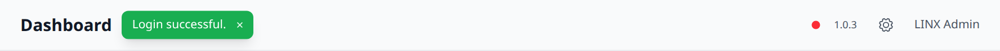
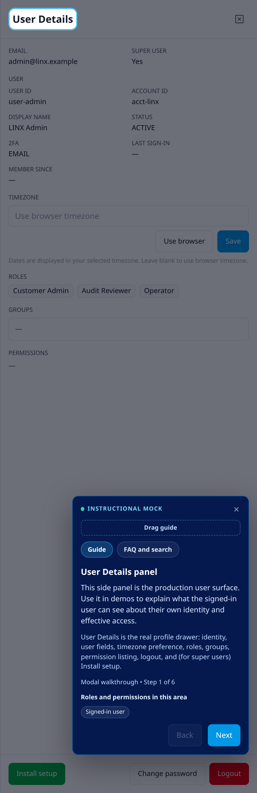
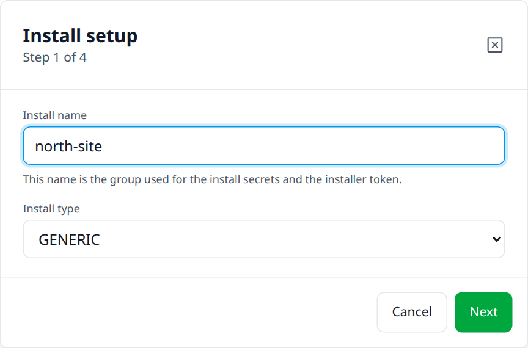
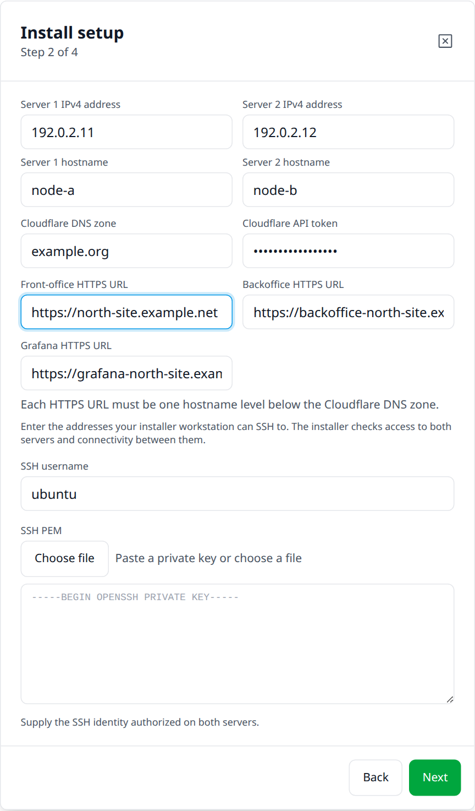
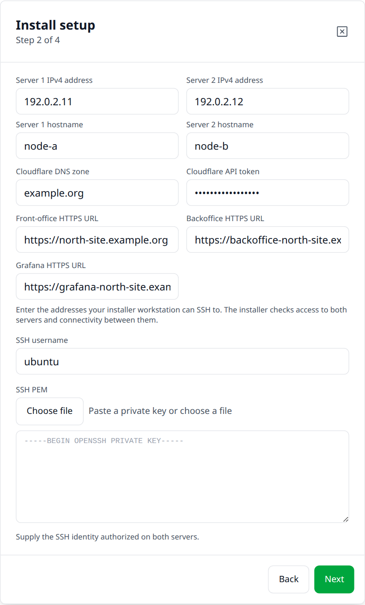
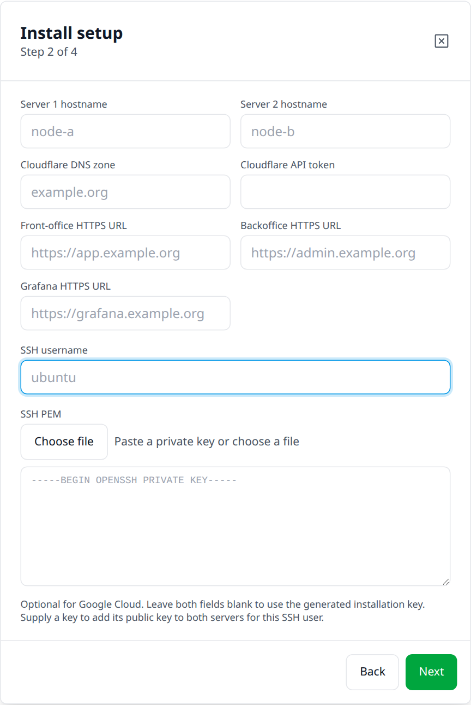
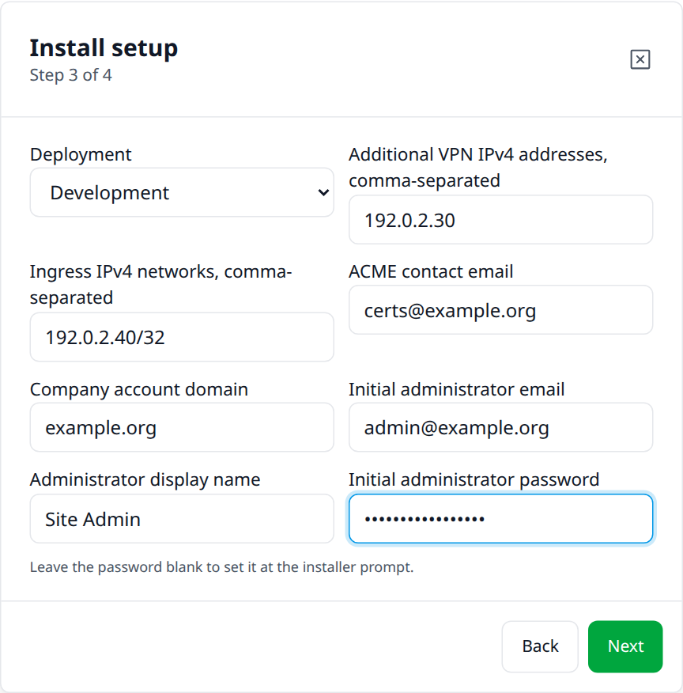
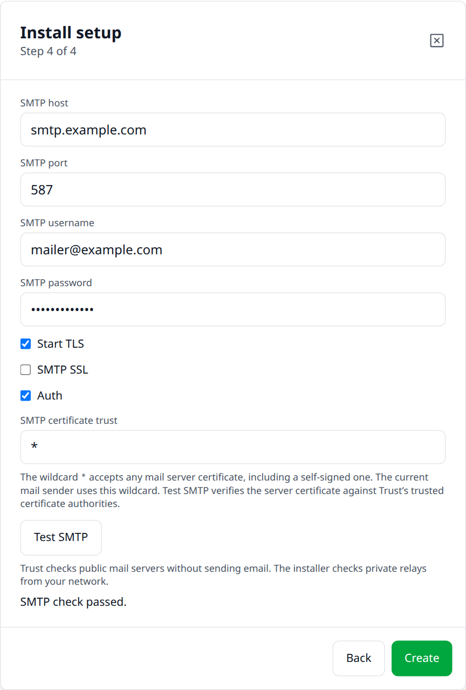
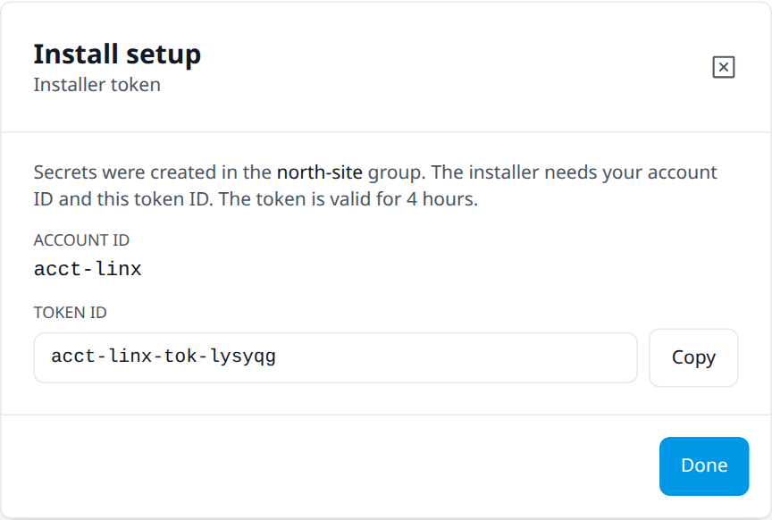

# Before you install CertLocker

| Prepare | Google Cloud | Existing servers (physical hosts or cloud VMs) |
| --- | --- | --- |
| Workstation | macOS or Linux with a working Google login and access to the project | macOS or Linux with OpenSSH and a route to both management addresses. Use the internet, a routed private network or a VPN, according to how you reach the hosts. |
| Machines | A billed project with Compute Engine enabled. Allow the installer to create two VMs, disks, addresses, networks and firewall rules in separate zones. Default per VM is 2 vCPUs, 8 GiB RAM and a 100 GiB boot disk. | Two dedicated Ubuntu 24.04 **amd64** hosts with distinct machine IDs. Choose your own instance size. We recommend **8 GiB RAM per host** for the full stack. On hosts below 6 GiB the installer sets smaller Java heap limits for the application services. Allow headroom for monitoring, PostgreSQL and concurrent JVM startup during an update. Size disk for application images, PostgreSQL and logs. Provision a non-root user with passwordless sudo on both. |
| SSH | The installer generates a key per installation. You can also authorize a customer key on both VMs. | Both hosts must already authorize the public half of the same provisioning key. Have the matching unencrypted private key available for Trust Install setup. |
| Routing | The installer creates the project networking. Prepare the operator and monitoring VPN egress IPv4 addresses. | Prepare both SSH IPv4 addresses, the workstation source address as seen by each host, and your client or load-balancer source ranges. Allow TCP 80 and 443 to both hosts. See the network checklist below. |
| DNS and TLS | Customer Cloudflare zone with DNS Edit and Zone Read for DNS-01. The default public routing also requires paid Cloudflare Load Balancing, Zone Load Balancers Edit and Account Load Balancing: Monitors and Pools Edit. | Customer Cloudflare zone with DNS Edit and Zone Read for DNS-01. Configure public or internal DNS for your application entry point. |
| Image access | Included in your hosted Trust installation config | Included in your hosted Trust installation config |

The optional bare-metal readiness check uses the same Trust account ID and hidden token as installation. To run the check directly on Linux, use Python 3.10+ with `cryptography`, OpenSSH, `findmnt` and a memory-backed `/dev/shm` for the temporary key. On macOS or when the native tools are missing, the launcher uses the packaged Linux controller through Docker. The controller must be able to SSH to both hosts over their public or private IPv4 addresses.

## Prepare the Trust installation

Sign in as a **super user**. Select your display name in the header to open **User Details**, then choose **Install setup** at the bottom left. The screenshots use example customer details. [Open Trust](https://trust.certlocker.io)

Find Install setup in User Details

1. **Name the installation and choose its type.** Choose **GENERIC** for existing machines or **GCP** for Google provisioning. The install name identifies the group containing your installation records.

   

2. **Set up SSH access.** For GENERIC, enter the two distinct management IPv4 addresses your installer workstation uses to reach the machines over SSH. Enter the two short hostnames in the same order. Both GENERIC and GCP accept the Cloudflare zone, front-office URL, backoffice URL, Grafana URL and zone API token. In GCP the server hostnames name the VMs that Terraform creates. Enter the non-root username with passwordless sudo and upload its private key. Both machines must authorize the matching public key. For GCP, leave both SSH fields blank to generate a dedicated install key. To add your own public key to both Google VMs as well, supply its matching username and private key here.

   Enter the Cloudflare zone as a domain, for example `example.org`. Each service needs a distinct HTTPS hostname directly under that zone, such as `https://app.example.org`. The grey examples are placeholders. Correct any mismatch before choosing **Next**.

   

DNS zone validation example

   

   

   

SSH for existing machines

   

   

   

SSH for Google Cloud

   

   

3. **Enter the site settings.** Select development or production. For GENERIC, the installer discovers and checks peer addresses over SSH. GCP supplies the private addresses. List the VPN egress IPv4 addresses allowed to access monitoring and the source networks used by your clients or load balancer. The controller also discovers its own SSH source on each server. Enter the ACME contact, company account domain, administrator email, display name and initial password. Leaving the password blank enables the installer's hidden prompt. Trust stores a supplied password in a separate group secret.

   

4. **Enter the application SMTP settings.** Have the SMTP host, port, username and password ready. Match the provider's TLS mode, typically STARTTLS on 587 or implicit TLS on 465. For Gmail, use the full mailbox address and an [App Password](https://myaccount.google.com/apppasswords).

   Select **Test SMTP** before creating the setup. Hosted Trust checks public IPv4 mail servers on ports 25, 465, 587 and 2525. It validates the TLS certificate when TLS is enabled and authenticates when **Auth** is selected. The check sends no email. For private relays or other ports, create the setup and let the installer check SMTP from your network.

   **SMTP certificate trust** controls which server certificates the mail sender accepts during TLS. The wildcard `*` accepts any certificate, including a self-signed one. The 1.1.30 mail sender always uses `*`, even when the installation configuration contains a hostname. The installer’s SMTP connectivity check separately verifies the certificate using the controller’s trusted certificate authorities.

   

SMTP example

   

   

5. **Copy the account ID and four-hour token.** Enter the account ID on your workstation and paste the token at the hidden prompt. For unattended runs, supply `--account-id` or `CERTLOCKER_ACCOUNT_ID` and inject `TRUST_TOKEN` or `CERTLOCKER_TOKEN` through your secret manager. Keep the token out of shell arguments and company JSON. On retry after expiration, use a fresh HTTPS SECRET token for the same account and install group.

   

### Registry and certificate credentials

For new installations, the grouped Trust configuration contains `image_pull_access`, a Base64-encoded registry login with the `read:packages` scope. Treat it as a credential. The installer decodes it in memory when preparing release image access. Older configurations can use their existing GHCR record or the legacy `--ghcr-token-file` option.

Use a Cloudflare **user API token** scoped to your zone. Enter it in Trust Install setup or at the installer’s hidden prompt. The installer reuses a valid credential in Trust and validates a replacement before saving it. For unattended recovery, supply the replacement through `CLOUDFLARE_API_TOKEN`. Network failures and rate limits leave the saved credential intact.

Have the ACME contact email, company domain, administrator display name, and front-office and backoffice HTTPS names ready. Use distinct names one level below your DNS zone. The default Grafana name is `grafana-cl-COMPANY.DNS_ZONE`.

## Bare-metal network checklist

| Connection | Requirement |
| --- | --- |
| Controller to both hosts | TCP 22 for SSH and TCP 80/443 for origin verification. Use a public IPv4 address or a reachable private IPv4 address. Keep the actual SSH source allowed for the duration of the installation. |
| Host to host | UDP 51820 both ways on the fixed peer addresses. On each host, the route to the other peer must select its own fixed address as the source. The installer checks for conflicts with the private mesh `10.210.0.0/16` and exchanges test datagrams before fresh enrollment. |
| Application clients or load balancer to both hosts | Open inbound TCP 80 and 443 on both hosts in provider security groups and upstream firewalls. Enter the client or load-balancer source ranges in Trust for the host firewall. A public load balancer can accept internet traffic and forward it from scoped source ranges. Pass additional source networks with `--ingress-cidr`. Supply individual monitoring VPN egress IPs with `--vpn-ip`. For Grafana, use a route that preserves an allowlisted source. |
| DNS | Point front-office and backoffice names at your public or private entry point. Point Grafana at an origin reachable from the allowed monitoring sources. For HA, configure the load balancer to check HTTPS `/health/ready` with the application hostname, and preserve session affinity for browser traffic. |
| Outbound | Allow DNS, OS package and mesh downloads, container registries, hosted Trust, Cloudflare, the ACME service and the configured SMTP endpoint. ACME DNS-01 validates the public TXT challenge for either routing configuration. |

On existing servers, inspect existing inbound rules with `sudo ufw status verbose`. Remove obsolete public SSH, Apache and bastion rules after confirming that your management source has its own SSH rule. The hardening check rejects unexpected public access.

For a rolling update, route clients to both healthy origins through a load balancer with HTTPS readiness checks. Duplicate hosts-file entries only allow manual origin testing. Keep the installer checkout, generated inventory and controller state available for updates and uninstall. Install from a workstation with access to the Trust instance that issued the setup record and ensure both hosts can reach the signed Ubuntu archive or the fallback mirror at mirrors.edge.kernel.org.

Use dedicated hosts. Setup manages Docker, UFW, SSH hardening, swap and the HA stack. An active HAProxy, web service or existing container workload needs its own host or a planned migration. The host check examines listeners and routes. The installed mesh verification tests actual encrypted peer traffic.

[Continue to installation](INSTALLATION.md)
